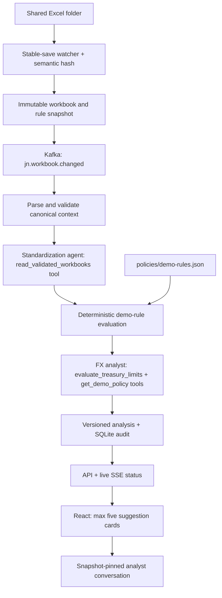

# JN Treasury FX Analyst — synthetic POC

Advisory-only React workspace for JMD, USD, GBP and CAD. All limits are **made-up demo rules**, not official JN or BOJ requirements. Original supplied policy documents are retained unchanged and are not enforced by this demo.

## Start on Windows

Prerequisites: Docker Desktop running, Python 3.12+, Node.js 20+.

Double-click `start.cmd`, then visit **http://127.0.0.1:8000**. Keep its terminal open. Initial analysis starts automatically and can take a minute because it invokes two agents. `Ctrl+C` stops the API; `docker compose stop` stops this POC's Kafka container without deleting it.

The supplied `apikey.txt` is read only on the server. Alternatively set `OPENAI_API_KEY`. Standardization defaults to `gpt-4.1-mini` (`OPENAI_MODEL` override). Suggestion writing, independent evidence review and chat default to `gpt-4.1` (`FX_ANALYST_MODEL` override). The key is never exposed to React, snapshots, or the audit database. Synthetic workbook context is sent to OpenAI when the key is available. Original policy PDFs are not uploaded.

In exploratory POC mode, numerical-wording matching is removed from suggestions and chat. Abbreviations, rounded figures, natural dates and numbered lists do not generate mechanical warnings. A separate factual review still produces **non-blocking warnings** for material financial concerns. The UI labels responses **manual review** and displays those warnings. Workbook validation and deterministic calculations are unchanged. Model outages, malformed card schemas and invalid structural references can still produce **Analyst unavailable**, with no substitute template cards. Chat returns model wording unchanged; provider failures still report unavailable.

## Demonstrate a change

1. Open `shared/Bank_Balances.xlsx` in Excel.
2. In `Accounts`, change the Citi USD balance in `D3` from `2400000` to `4000000`.
3. Save. The UI shows detection, gathering, standardization, policy checks and analysis; the USD funding warning clears after recalculation.
4. To clear the reserve warning independently, increase the USD reserve in `Reserves!C3` from `460000` to `500000`.
5. Click any suggestion to inspect its arithmetic, source rows and rule version, or ask the analyst a follow-up question.

Formatting-only saves do not rerun the agents. Excel temporary files are ignored. Changes to `policies/demo-rules.json` or `backend/prompts/fx_analyst.md` also trigger analysis. The watcher requires four seconds of stable observations, retries locked/incomplete files and retains the last successful result if a workbook is invalid. Use numeric cells rather than formulas: openpyxl reads Excel's saved formula result and does not calculate formulas itself.

### Suggestion sounds

Open **Sound off** in the header and click **Enable notification sounds**. Browsers require this user gesture after opening the page. There are three original synthesized candy-like chimes: an info sparkle, a bouncy warning and a friendly critical attention bell. Preview each sound in the menu; previews do not turn on notifications. Volume is saved locally. Mute immediately cancels queued sounds. New or changed suggestion cards play in sequence rather than overlapping; unchanged cards, reconnects and loading an existing snapshot stay silent. No Candy Crush recordings or other game assets are used.

The workbooks are generated only when absent; startup never overwrites edits. Synthetic dates are set at creation. Refresh workbook dates as the demo week advances. Cancelled and settled flows are excluded; unsettled flows before today or after the seven-day window are outside this simple forecast. Receipts are assumed to arrive before payments within each day; this is a daily, not intraday, model. Reserve entries are synthetic accounting balances, not an assertion about JN's actual BOJ account structure.

### LCR and NSFR dashboard

The overview displays **LCR (30-day stress)** and **NSFR (one-year funding structure)** with labelled Good / Normal / At risk indicators. Both use **demo bands**: below 100% = At risk, 100% to below 120% = Normal, 120% or more = Good. These bands are configurable in `policies/demo-rules.json`; they are not asserted to be official BOJ status bands or NSFR requirements.

Inputs live in the new `Liquidity_Inputs` tab of `Bank_Balances.xlsx`. Startup adds this tab if absent without changing existing balances, receipts or payments. All amounts are **total JMD-equivalent synthetic, pre-adjusted aggregates**:

- LCR = eligible HQLA / (30-day stressed outflows − min(eligible inflows, 75% of stressed outflows) + maturity-mismatch add-on) × 100.
- NSFR = weighted available stable funding / weighted required stable funding × 100.

This is not an implementation of regulatory eligibility, security-level haircuts, HQLA composition limits, deposit runoff classifications or ASF/RSF factors: those are assumed to have already been applied to the synthetic aggregates. The inputs are separate from the seven-day operating cash forecast. Changing an operating balance alone does not change these ratios; update the corresponding synthetic liquidity/funding aggregates too. Expand **How this is calculated** for arithmetic, input timestamps and source rows. A ratio below the demo floor also creates a critical analyst finding, subject to the five-card limit. Historical analyses created before this feature remain unchanged.

## Modules

| Location | Purpose |
|---|---|
| `shared/*.xlsx` | Three editable synthetic source workbooks |
| `policies/demo-rules.json` | Complete versioned demo thresholds |
| `backend/calculations.py` | Deterministic Decimal arithmetic and checks |
| `backend/liquidity_metrics.py` | Synthetic LCR/NSFR ratios, status bands and input definitions |
| `backend/analyst.py` | Analyst output schema, evidence catalog, validation and hypothetical FX-conversion calculations |
| `backend/prompts/fx_analyst.md` | Editable analyst role, priorities, safety boundaries, writing and follow-up instructions |
| `backend/app.py` | Watcher, snapshots, Kafka producer/consumer, agent tools, API, SSE and audit persistence |
| `backend/seed.py` | Non-destructive workbook generation |
| `frontend/src/` | React UI, detail drawer, chat, data and rule views |
| `runtime/snapshots/<run-id>/` | Immutable workbook copies, rules and analysis |
| `runtime/audit.sqlite` | Analyses and suggestion-specific conversations |

## Event and agent architecture



The agents use real OpenAI function tools. The calculation engine produces **findings and facts only**, never final cards. Its legacy narrative templates are excluded from the writer's evaluation tool. The analyst selects and writes zero to five original suggestions. Structural schema/count/duplicate/reference checks, critical-finding coverage and original-wording checks remain blocking, with one regeneration attempt. There is no regex-based numerical-token or monetary-wording matching. Material currency/amount contradictions are left to the non-blocking factual reviewer and human review.

Citations are checked as authored, not inferred by matching numerical tokens. `authored_fact_ids` are retained; `resolved_fact_ids` stays empty on new runs for compatibility with historical audits. The audit records `numerical_wording_check: false`. `validation_mode: narrative_warnings` and `validation_warnings` remain the existing response fields, now carrying only factual-review concerns or reviewer unavailability. Historical snapshots and chat messages are not rewritten.

The analyst's mandate is open-ended: topics are self-chosen, not a fixed list. Full workbook review is mandatory; findings are risk evidence, not a menu of cards. Cards may omit finding/rule references when none applies, but still need relevant workbook-backed facts. Critical-risk coverage and the five-card limit remain enforced. Grounded figures and tool-tested transaction proposals remain instructions; factual concerns do not veto publishing. Human approval and no execution remain unchanged.

### Funding-request experiment

#### Analyst generation

The analyst reads evidence and optionally uses calculation tools in a single eight-turn loop. There is no separate investigation memo, completion gate or presentation stage. Four evidence calls remain required; simulations are analyst-selected. Factual review is non-blocking; numerical-wording checks are removed. Structural failures allow one regeneration attempt. Historical audits are unchanged.

#### Analyst-proposed funding-plan tool

`assess_funding_plan` is an optional Python calculation tool, not an agent or an opportunity-ranking engine. The analyst chooses the source currency, recorded active payment ID, destination-currency amount to acquire, settlement date, source-currency fee assumption and Expected-receipt delay assumption. The tool computes the source principal (rounded up to cents), dated source/target balances, buffer headroom and remaining gaps, cash coverage through the obligation, synthetic exposure impact, and baseline/delayed/no-Expected-receipt checks. Each assessment is independent; hypothetical plans are not accumulated. The original payment is already included in the forecast and is not deducted twice. Results and numerical facts are available to suggestion generation, its independent reviewer and snapshot-pinned follow-up chat.

It does not discover a plan, choose a currency or approve a trade. It is not a required tool call. No balances or rates are edited. Source debit is checked against the previous close rather than presumed same-day incoming funds; destination credit before the same-day obligation is an explicit, unverified assumption. Future settlement uses current illustrative sheet bid/ask prices, not forward/executable quotes. Only supplied fees are included (zero means unspecified costs), no carry or profitability is calculated, and independently maintained risk inputs receive a conversion-only adjustment. Passing the modeled checks does not establish execution readiness or actual regulatory compliance. Protected reserves and independent LCR/NSFR inputs are untouched.

The operating forecast now spans 28 days (today plus 28 days, 29 daily observations), controlled by `forecast_days`. It is a daily-net recorded-flow forecast, not a complete commitment schedule or intraday settlement model. The baseline includes active Expected receipts and active Expected payments; Expected payments are tentative requests included conservatively, not approvals. A separate `confirmed_receipts_balance` / `confirmed_receipts_low` scenario excludes Expected receipts while keeping all active payments. Confirmed and Committed receipts remain scheduled assumptions, not guarantees. Both views are available to the analyst, and conversion simulations adjust both source-currency lows.

`python -m backend.funding_scenario` previews an opt-in synthetic experiment. `python -m backend.funding_scenario --apply` appends nine payments and nine deposits to the existing disbursements workbook, preserving original rows, balances and rates, updating table ranges and backing up the workbook under `runtime/experiments/`. It refuses a second application if scenario IDs already exist; it is never run on startup. Rows use `SIM-FUNDING-` IDs and synthetic descriptions. The sample includes a confirmed USD loan drawdown in three weeks, a short-notice USD request, a tentative request, other currency obligations and deposits of differing certainty. These are sample cash flows, not a claim of schedule completeness. No action is encoded in a workbook description, and no specific conversion output is asserted in tests.

The first live experiment's actual output is retained in `runtime/funding-experiment-result.json`. It identified USD funding and GBP deposit-dependency risks but did not choose or simulate a specific FX conversion. This is an observed outcome, not evidence that the system reliably selects an optimal funding strategy. Existing independent risk inputs also show an exposure-limit warning; operating balance edits do not automatically reconcile those inputs.

After structural validation, a fresh-context model reviews the proposed advice for factual errors. Concerns are retained as warnings, never rewritten into the cards and never used to force regeneration. A failed or malformed reviewer response also produces a warning and does not hide authored cards. This exploratory setting can publish incorrect conclusions; manual review is essential.

Required policy, evaluation and evidence-catalog tool calls are enforced by the client. Additional tools expose validated context, the prior snapshot, and hypothetical FX conversion calculations. Simulations use bank-perspective sheet buying/selling rates, leave reserves untouched, show source-buffer/exposure impacts and execute nothing. They assume immediate settlement before fees and do not recalculate independent LCR/NSFR aggregates.

Each run snapshots instructions and records their hash, model, copied tool results, validation outcomes, warnings and evidence catalog. New exploratory cards display **AI authored · manual review**. Older runs retain their original validation labels. `suggestion_origin: unavailable` remains explicit for model/structural failures; no templates replace missing model advice.

The simplified FX exposure measure is the sum of absolute foreign-currency exposures translated at the rate-sheet selling rate, divided by a single JMD capital base. It is **not regulatory net open position**. Reserves are in a separate worksheet and never included in available operational funds.

## Integrating real rules later

Replace thresholds in the rule file, add or replace formulas in `backend/calculations.py`, and add worked-example tests. New rule families may require new workbook columns and validation. Source PDFs can be registered later with source/page citations. Do not silently relabel demo calculations as regulatory calculations. Every snapshot stores the rule version used; bump the version when changing rules. Code changes require restarting the API.

## Tests and builds

```powershell
.\.venv\Scripts\python.exe -m unittest discover -s tests -v
```

From `frontend/`, run `npm.cmd run build`. For front-end development, run `npm.cmd run dev` alongside the API; Vite proxies `/api` to port 8000.

Sound notification tests (Node.js 24+) from `frontend/`: `node --experimental-strip-types --test tests/sounds.test.ts`.

## POC boundaries

- Localhost only; no authentication, production access controls or trade execution.
- Single local worker and Kafka broker; Kafka files live inside the container. SQLite and input snapshots live on the host. Removing/recreating the broker loses its event log; successful analyses remain in SQLite.
- A fresh startup takes a new snapshot. Successful Kafka event IDs are deduplicated through SQLite; analysis failures are shown and require a subsequent input edit or restart to retry.
- No bank integrations, live market feed, regulatory certification, regulatory-grade LCR/NSFR reporting or automated transfers.
- No guarantees about intraday liquidity, receipt certainty, settlement cutoffs or business-day calendars.
- Keep real customer/bank data out of this synthetic demo unless its hosting and model-provider processing are separately approved.
