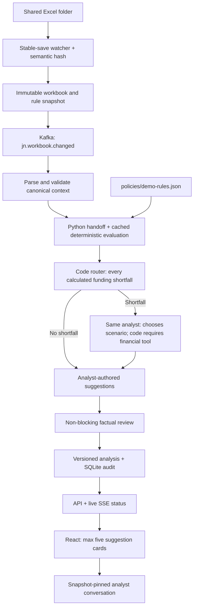

# JN Treasury FX Analyst — synthetic POC

Advisory-only React workspace for JMD, USD, GBP and CAD. All limits are **made-up demo rules**, not official JN or BOJ requirements. Original supplied policy documents are retained unchanged and are not enforced by this demo.

## Start on Windows

Prerequisites: Docker Desktop running, Python 3.12+, Node.js 20+.

Double-click `start.cmd`, then visit **http://127.0.0.1:8000**. Keep its terminal open. Startup restores saved results and does **not** start a paid analysis. Click **Run analyst** to request a fresh analysis (`POST /api/analyse`). Meaningful workbook or demo-rule changes while the app is running still trigger analysis. Refreshing the browser, restarting the app, formatting saves and prompt-only edits do not. `Ctrl+C` stops the API; `docker compose stop` stops this POC's Kafka container without deleting it.

The supplied `apikey.txt` is read only on the server. Alternatively set `OPENAI_API_KEY`. Standardization is Python-only, with no model request. Funding assessment, suggestion writing, independent factual review and chat continue to use `gpt-4.1` (`FX_ANALYST_MODEL` override). The key is never exposed to React, snapshots, or the audit database. Compact synthetic workbook context is sent to OpenAI during requested/changed-input analyses and follow-up chat. Original policy PDFs are not uploaded.

In exploratory POC mode, numerical-wording matching is removed from suggestions and chat. Abbreviations, rounded figures, natural dates and numbered lists do not generate mechanical warnings. A separate factual review still produces **non-blocking warnings** inside the relevant **Explore insight** detail, without labels or warning clutter on the compact cards. Workbook validation and deterministic calculations are unchanged. Model outages, malformed card schemas and invalid structural references can still produce **Analyst unavailable**, with no substitute template cards and **no automatic paid rewrite**. Chat returns model wording unchanged; provider failures still report unavailable.

## Demonstrate a change

1. Open `shared/Bank_Balances.xlsx` in Excel.
2. Review the existing, user-edited values. Do not reset the live portfolio to the original seed example.
3. Make an intentional business-value edit and save. The UI shows gathering, Python validation, calculation and analyst progress; a genuine change triggers a paid analysis.
4. To analyse unchanged data intentionally, click **Run analyst** once. Repeated clicks while the same run is active reuse that in-progress request rather than queueing duplicates.
5. Click any suggestion to inspect its arithmetic, source rows and rule version, or ask the analyst a follow-up question.

Formatting-only saves do not rerun the analyst. Excel temporary files are ignored. Semantic changes to `policies/demo-rules.json` trigger analysis; edits to `backend/prompts/fx_analyst.md` are used on the next requested or business-change analysis, not a trigger themselves. The watcher waits for stable observations and preserves saved results if inputs are invalid. A failed enqueue is not retried automatically until another save or an explicit request. Use numeric cells rather than formulas: openpyxl reads Excel's saved formula result and does not calculate formulas itself.

### Suggestion sounds

Open **Sound off** in the header and click **Enable notification sounds**. Browsers require this user gesture after opening the page. There are three original synthesized candy-like chimes: an info sparkle, a bouncy warning and a friendly critical attention bell. Preview each sound in the menu; previews do not turn on notifications. Volume is saved locally. Mute immediately cancels queued sounds. New or changed suggestion cards play in sequence rather than overlapping; unchanged cards, reconnects and loading an existing snapshot stay silent. No Candy Crush recordings or other game assets are used.

The workbooks are generated only when absent; startup never overwrites edits. Synthetic dates are set at creation. Refresh workbook dates as the demo week advances. Cancelled and settled flows are excluded; unsettled flows before today or after the seven-day window are outside this simple forecast. Receipts are assumed to arrive before payments within each day; this is a daily, not intraday, model. Reserve entries are synthetic accounting balances, not an assertion about JN's actual BOJ account structure.

### LCR and NSFR dashboard

The overview displays **LCR (30-day stress)** and **NSFR (one-year funding structure)** with labelled Good / Normal / At risk indicators. Both use **demo bands**: below 100% = At risk, 100% to below 120% = Normal, 120% or more = Good. These bands are configurable in `policies/demo-rules.json`; they are not asserted to be official BOJ status bands or NSFR requirements.

Inputs live in the new `Liquidity_Inputs` tab of `Bank_Balances.xlsx`. Startup adds this tab if absent without changing existing balances, receipts or payments. All amounts are **total JMD-equivalent synthetic, pre-adjusted aggregates**:

- LCR = eligible HQLA / (30-day stressed outflows − min(eligible inflows, 75% of stressed outflows) + maturity-mismatch add-on) × 100.
- NSFR = weighted available stable funding / weighted required stable funding × 100.

This is not an implementation of regulatory eligibility, security-level haircuts, HQLA composition limits, deposit runoff classifications or ASF/RSF factors: those are assumed to have already been applied to the synthetic aggregates. The inputs are separate from the seven-day operating cash forecast. Changing an operating balance alone does not change these ratios; update the corresponding synthetic liquidity/funding aggregates too. Expand **How this is calculated** for arithmetic, input timestamps and source rows. A ratio below the demo floor also creates a critical analyst finding, subject to the five-card limit. Historical analyses created before this feature remain unchanged.

## Modules

| Location | Purpose |
|---|---|
| `shared/*.xlsx` | Three editable synthetic source workbooks |
| `policies/demo-rules.json` | Complete versioned demo thresholds |
| `backend/calculations.py` | Deterministic Decimal arithmetic and checks |
| `backend/calculation_cache.py` | Reuse deterministic results for unchanged inputs, date and quote freshness |
| `backend/model_context.py` | Compact model views and repeat-tool calculation reuse; full local provenance retained |
| `backend/liquidity_metrics.py` | Synthetic LCR/NSFR ratios, status bands and input definitions |
| `backend/analyst.py` | Analyst output schema, evidence catalog, validation and hypothetical FX-conversion calculations |
| `backend/prompts/fx_analyst.md` | Editable analyst role, priorities, safety boundaries, writing and follow-up instructions |
| `backend/app.py` | Watcher, snapshots, Kafka producer/consumer, agent tools, API, SSE and audit persistence |
| `backend/seed.py` | Non-destructive workbook generation |
| `frontend/src/` | React UI, detail drawer, chat, data and rule views |
| `runtime/snapshots/<run-id>/` | Immutable workbook copies, rules and analysis |
| `runtime/audit.sqlite` | Analyses and suggestion-specific conversations |

## Event and agent architecture



The analyst uses real OpenAI function tools. The calculation engine produces **findings and facts only**, never final cards. Its legacy narrative templates are excluded from the writer's evaluation tool. The analyst selects and writes zero to five original suggestions. Structural schema/count/duplicate/reference checks, critical-finding coverage and original-wording checks remain; failed output is reported once, without an automatic regeneration. There is no regex-based numerical-token or monetary-wording matching. Material currency/amount contradictions are left to the non-blocking factual reviewer and human review.

Citations are checked as authored, not inferred by matching numerical tokens. `authored_fact_ids` are retained; `resolved_fact_ids` stays empty on new runs for compatibility with historical audits. The audit records `numerical_wording_check: false`. `validation_mode: narrative_warnings` and `validation_warnings` carry planning/assessment limitations and non-blocking factual concerns. Historical snapshots and chat messages are not rewritten.

The factual reviewer returns explicit suggestion IDs for each concern. Each affected suggestion carries `review_warnings`, displayed only inside its **Explore insight** detail, not on its compact card. `analysis_review_warnings` separates brief-wide concerns, workflow limitations and reviewer unavailability; these are labelled snapshot-wide in the detail and snapshot summary. The flattened `validation_warnings` remains for audit compatibility. Older unscoped warnings stay clearly labelled as legacy snapshot notes rather than being guessed onto cards. Warning assignment never blocks publication.

The analyst's mandate is open-ended: topics are self-chosen, not a fixed list. Full workbook review is mandatory; findings are risk evidence, not a menu of cards. Cards may omit finding/rule references when none applies, but still need relevant workbook-backed facts. Critical-risk coverage and the five-card limit remain enforced. Grounded figures and tool-tested transaction proposals remain instructions; factual concerns do not veto publishing. Human approval and no execution remain unchanged.

Suggestion writing uses a calm, helpful-colleague voice: short everyday sentences about what could happen, what could help and what conditions still matter. Tone examples in `backend/prompts/fx_analyst.md` guide the existing writer, not a separate rewriting model. Summaries may use two or three short sentences within the existing character limit. Financial checks, severity and citations are unchanged; saved cards are not rewritten. The new voice applies on the next requested or meaningful-input-change analysis; editing the prompt alone does not start a paid run.

### Funding-request experiment

#### Analyst generation

`backend/orchestrator.py` implements a small LangGraph `StateGraph`: code-routed funding assessments → suggestion writing. There is **no AI planning call** and no AI standardization. The analyst receives the validated workbook values, calculated forecasts, rules and a short previous-snapshot summary, with repeated provenance removed. It independently discovers opportunities; code never prescribes a source currency or winning trade.

Code creates one funding task per currency with a baseline or no-Expected-receipts buffer gap. For recorded active payments within the forecast, `assess_funding_plan` is a required tool call. If no such payment exists, `simulate_fx_conversion` is required instead. The analyst chooses the source, amount, eligible obligation and settlement date; code executes the tool and returns actual results. Failed tool inputs can still be corrected within the existing eight-turn tool loop; this is distinct from the removed automatic card rewrite. Additional comparisons remain analyst-selected, not an exhaustive search or an optimization guarantee.

Assessment errors, tool-loop exhaustion and late service failures retain returned results and proceed to writing with explicit warnings. A failed modeled plan counts as an assessment, not a suitable recommendation. No completeness judge approves research or suppresses the writer. When no currency needs funding, the mandatory assessment branch is skipped; the writer may still investigate self-selected opportunities with tools. Baseline evidence is supplied upfront rather than consuming mandatory retrieval turns.

The writer receives compact funding calculations, checks, remaining gaps and exact fact IDs. Repeated daily scenario rows, AI memos and duplicate full traces are not resent with the catalog. The full-precision original results and provenance stay local in immutable audits and workbook evidence. The reviewer receives the proposed claims, cited facts, small baseline checks and scenario summaries—not the full workbooks, catalog or daily forecasts. Outputs are shorter, while the financial tools and review remain available.

Audit `workflow_version: compact-routing-2` records routing, statuses and full local traces; `automatic_rewrites: false` documents the single card-generation attempt. The existing model is unchanged. There are **no new spending controls, call-count caps, usage meters or daily budgets**. Fewer requests are expected, not guaranteed: a no-shortfall run normally needs writing plus factual review; one shortfall normally also needs the analyst's financial-tool interaction. Optional investigations can add requests. No paid calls are needed for tests.

Deterministic baseline calculations are cached under `runtime/calculation-cache/`, keyed by full inputs/provenance, rules, calculation code, forecast date and quote-freshness status. Unchanged same-day results can be reused; balance/rule changes, midnight, quote-age threshold crossings and calculation changes invalidate the cache. Identical financial-tool inputs within a snapshot reuse independent copies of the result. AI recommendations are never substituted with calculation templates.

#### Analyst-proposed funding-plan tool

`assess_funding_plan` is a Python calculation tool, not another agent or an opportunity-ranking engine. It is required on the routed recorded-obligation shortfall path and optional for additional investigation and chat. The analyst chooses the source currency, recorded active payment ID, destination-currency amount to acquire, settlement date, source-currency fee assumption and Expected-receipt delay assumption. The tool computes the source principal (rounded up to cents), dated source/target balances, buffer headroom and remaining gaps, cash coverage through the obligation, synthetic exposure impact, and baseline/delayed/no-Expected-receipt checks. Each assessment is independent; hypothetical plans are not accumulated. The original payment is already included in the forecast and is not deducted twice. Results and numerical facts are available to suggestion generation, its independent reviewer and snapshot-pinned follow-up chat.

It does not discover a plan, choose a currency or approve a trade. No balances or rates are edited. Source debit is checked against the previous close rather than presumed same-day incoming funds; destination credit before the same-day obligation is an explicit, unverified assumption. Future settlement uses current illustrative sheet bid/ask prices, not forward/executable quotes. Only supplied fees are included (zero means unspecified costs), no carry or profitability is calculated, and independently maintained risk inputs receive a conversion-only adjustment. Passing the modeled checks does not establish execution readiness or actual regulatory compliance. Protected reserves and independent LCR/NSFR inputs are untouched.

The operating forecast now spans 28 days (today plus 28 days, 29 daily observations), controlled by `forecast_days`. It is a daily-net recorded-flow forecast, not a complete commitment schedule or intraday settlement model. The baseline includes active Expected receipts and active Expected payments; Expected payments are tentative requests included conservatively, not approvals. A separate `confirmed_receipts_balance` / `confirmed_receipts_low` scenario excludes Expected receipts while keeping all active payments. Confirmed and Committed receipts remain scheduled assumptions, not guarantees. Both views are available to the analyst, and conversion simulations adjust both source-currency lows.

`python -m backend.funding_scenario` previews an opt-in synthetic experiment. `python -m backend.funding_scenario --apply` appends nine payments and nine deposits to the existing disbursements workbook, preserving original rows, balances and rates, updating table ranges and backing up the workbook under `runtime/experiments/`. It refuses a second application if scenario IDs already exist; it is never run on startup. Rows use `SIM-FUNDING-` IDs and synthetic descriptions. The sample includes a confirmed USD loan drawdown in three weeks, a short-notice USD request, a tentative request, other currency obligations and deposits of differing certainty. These are sample cash flows, not a claim of schedule completeness. No action is encoded in a workbook description, and no specific conversion output is asserted in tests.

The first live experiment's actual output is retained in `runtime/funding-experiment-result.json`. It identified USD funding and GBP deposit-dependency risks but did not choose or simulate a specific FX conversion. This is an observed outcome, not evidence that the system reliably selects an optimal funding strategy. Existing independent risk inputs also show an exposure-limit warning; operating balance edits do not automatically reconcile those inputs.

After structural validation, a fresh-context model reviews the proposed advice for factual errors. Concerns are retained as warnings, never rewritten into the cards and never used to force regeneration. A failed or malformed reviewer response also produces a warning and does not hide authored cards. This exploratory setting can publish incorrect conclusions; manual review is essential.

The client enforces the financial tool required by each routed funding task; failed tool calls return errors for correction. Read tools expose full context, policy, forecasts, evidence and previous snapshots without a retrieval quota during writing. Simulations use bank-perspective sheet buying/selling rates, leave reserves untouched, show source-buffer/exposure impacts and execute nothing. Immediate conversions assume immediate settlement before fees; funding plans use the selected dates and supplied fees. Neither recalculates independent LCR/NSFR aggregates.

Each run snapshots instructions and records their hash, model, copied tool results, validation outcomes, warnings and full evidence catalog. Review notes stay inside insight details; no authorship badge occupies card space. `suggestion_origin: unavailable` remains explicit for model/structural failures; no templates replace missing model advice. Historical audits are unchanged.

The simplified FX exposure measure is the sum of absolute foreign-currency exposures translated at the rate-sheet selling rate, divided by a single JMD capital base. It is **not regulatory net open position**. Reserves are in a separate worksheet and never included in available operational funds.

## Integrating real rules later

Replace thresholds in the rule file, add or replace formulas in `backend/calculations.py`, and add worked-example tests. New rule families may require new workbook columns and validation. Source PDFs can be registered later with source/page citations. Do not silently relabel demo calculations as regulatory calculations. Every snapshot stores the rule version used; bump the version when changing rules. Code changes require restarting the API.

## Tests and builds

```powershell
.\.venv\Scripts\python.exe -m unittest discover -s tests -v
```

From `frontend/`, run `npm.cmd run build`. For front-end development, run `npm.cmd run dev` alongside the API; Vite proxies `/api` to port 8000.

Front-end tests (Node.js 24+) from `frontend/`: `node --experimental-strip-types --test tests/sounds.test.ts tests/reviewNotes.test.mjs`.

## POC boundaries

- Localhost only; no authentication, production access controls or trade execution.
- Single local worker and Kafka broker; Kafka files live inside the container. SQLite and input snapshots live on the host. Removing/recreating the broker loses its event log; successful analyses remain in SQLite.
- Startup restores saved results and establishes an input baseline without a new analysis. Events from previous app boots are not replayed into paid work. Completed event IDs are deduplicated through SQLite; failures require **Run analyst** or a subsequent meaningful input edit, not a restart, to retry.
- No bank integrations, live market feed, regulatory certification, regulatory-grade LCR/NSFR reporting or automated transfers.
- No guarantees about intraday liquidity, receipt certainty, settlement cutoffs or business-day calendars.
- Keep real customer/bank data out of this synthetic demo unless its hosting and model-provider processing are separately approved.
